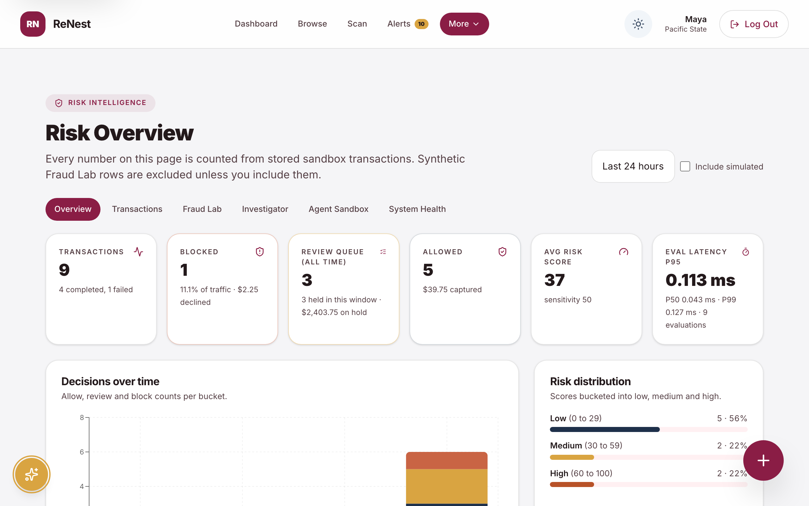
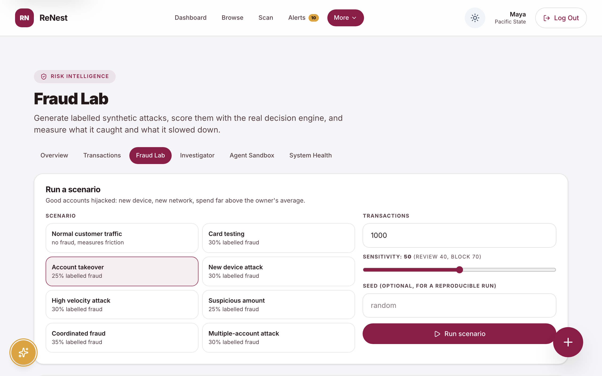
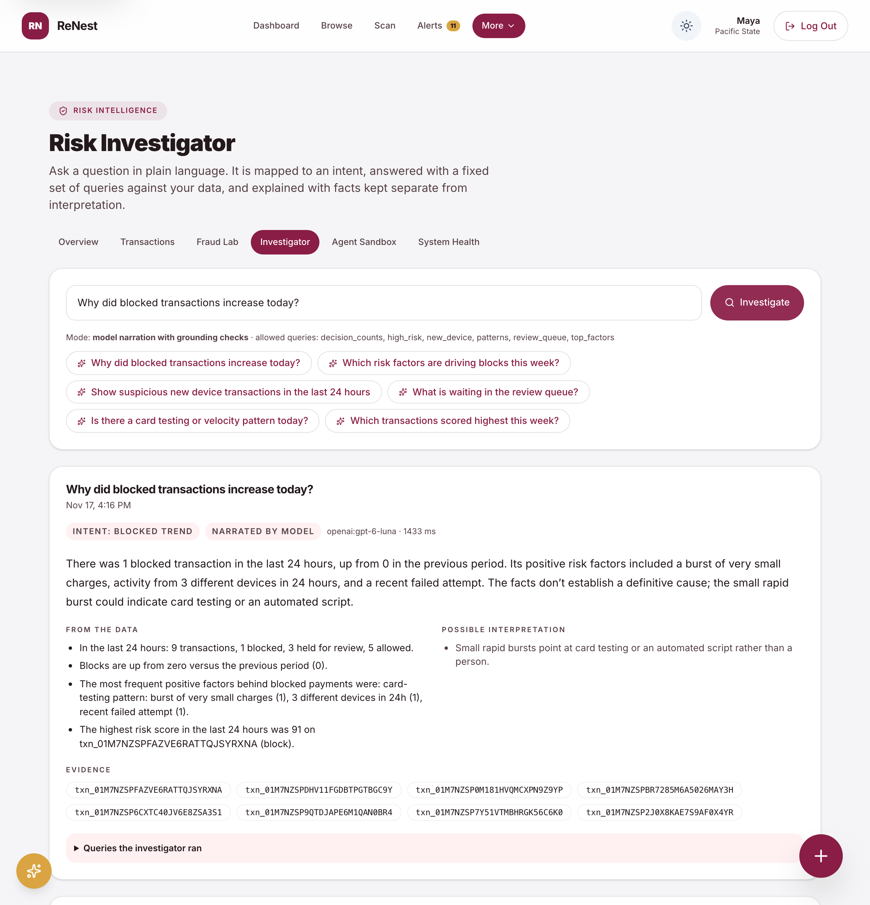

# ReNest Risk Intelligence

Risk Intelligence is a demo that sits inside ReNest. It takes pretend payments, decides whether each one looks safe, and explains why.

**No real money moves anywhere in it.** Every payment is a sandbox payment.

You find it at `/risk` in the app. Its API lives under `/api/risk/`.



## Why it exists

A campus marketplace sees many small payments from new accounts on shared Wi-Fi. That is also what fraud looks like: people testing stolen cards, taking over accounts, or opening many accounts to abuse an offer.

A system that handles such payments has to do five things:

1. Decide in a few milliseconds, and give a reason a person can read.
2. Never charge twice when the same request arrives again.
3. Never lose a follow-up step, such as telling the customer.
4. Keep a record of what happened that nobody can edit afterwards.
5. Measure how much fraud it catches against how many honest people it slows down, instead of guessing.

This demo shows one way to do each of them.

## The pages

| Page | What you see |
|---|---|
| Risk Overview (`/risk`) | How many payments were allowed, held for review or blocked, how fast decisions were made, a live feed, and a form to create a sandbox payment |
| Transactions (`/risk/transactions`) | Every payment, with search and filters |
| One transaction (`/risk/transactions/:id`) | The score, each reason behind it, what the system knew at the time, and the full history of that payment. Staff can approve or reject a held payment here |
| Fraud Lab (`/risk/lab`) | Made-up attacks run through the real scoring rules, with a report on what was caught and what was missed |
| Investigator (`/risk/investigator`) | Questions in plain language, answered from the data, with facts and guesses kept apart |
| Agent Sandbox (`/risk/agents`) | Spending rules for automated buyers, and a reasoned verdict for every purchase they attempt |
| System Health (`/risk/health`) | Counters, response times, the event queue, and events that failed and can be retried |

Every number on these pages is counted from stored records. Made-up Fraud Lab records are marked as simulated. They stay out of the real figures unless you choose to include them, and then they are labelled.

## How a payment is processed


In words:

1. A request arrives. It can carry a label called an idempotency key, which lets the server recognise a repeat of the same request.
2. If the key was seen before, the server sends back the earlier answer and stops.
3. Otherwise it saves the payment, scores it, records the decision and writes its events. These are saved together in one step. Either all of it is stored or none of it is.
4. After that step is safely stored, the follow-up work runs, and an allowed payment is sent to the sandbox processor.

It all runs on the same server and database as the rest of ReNest. There is no separate message queue. The events are rows in a database table, and the same code handles them right after the payment, from the scheduled job, or from a dedicated worker.

## How the score works

Each payment gets a score from 0 to 100. A higher score means more risk.

The score comes from a list of rules. Each rule looks at one thing and adds or removes points. Signs of trust remove points. The points are added up and kept between 0 and 100.

Two limits turn the score into a decision:

- below the review limit, the payment is **allowed**
- between the two limits, it is **held for review**
- at or above the block limit, it is **blocked**

This is what the engine returns for one payment:

```python
RiskDecision(
    decision="block",              # allow, review or block
    risk_score=74,                 # 0 to 100
    confidence=0.83,               # a rough indicator, not a probability
    reasons=["amount_vs_history", "new_device", "ip_churn", "unusual_hour"],
    factors=[RuleResult(code, points, label, detail), ...],
    thresholds=Thresholds(sensitivity=50, review=40, block=70),
    model_version="risk-rules-v2",
    evaluation_time_ms=0.031,      # how long the decision took
    explanation="RISK SCORE: 74 / 100\n+34 ...",
)
```

### The rules

The rules live in `risk/engine/rules.py`, one small class each. Adding a rule means adding one class.

The point values were chosen by hand. This is a demonstration model. It was not trained on real fraud data.

| Rule | Points | When it applies |
|---|---|---|
| Amount versus history | +12 / +22 / +34 | The amount is 2, 3 or 6 times the customer's average, and they have at least three successful payments |
| Large first payment | +10 / +18 | No successful payment yet, and the amount is at least 200 / 1,000 |
| Extreme amount | +12 / +35 | The amount is at least 1,000 / 2,000 |
| New device | +21 | An established account on a device it has never used |
| Known device | -12 | A device used three or more times before, first seen at least a day ago |
| Device shared by accounts | +24 | Three or more accounts on one device in 24 hours |
| Many devices | +16 | Three or more devices in 24 hours |
| Many networks | +15 | Four or more networks in 24 hours |
| Payments per hour | +18 / +30 | 3 / 5 or more payments in the last hour |
| Payments per day | +10 / +20 | 8 / 15 or more payments in 24 hours |
| Card testing | +28 | An amount under 5, and four or more payments in the hour |
| Account age | +18 / +11 / +5 / -6 | Younger than 1 day / 7 days / 30 days. Older than 180 days removes points |
| Failed attempts | +7 / +20 | 1 / 3 or more failed or blocked payments in 24 hours |
| Trusted customer | -8 / -15 | 3 / 10 or more successful payments and no recent failure |
| New currency | +8 | First payment in a currency the account has never used |
| Unusual hour | +4 | Between 01:00 and 05:00 in the campus time zone |
| New merchant, large amount | +6 | First time at a merchant, and twice the customer's average |

### Comparing amounts in different currencies

Amounts are compared as an approximate US dollar value, so 2,000 yen is not treated like 2,000 dollars. The rates come from a small fixed table in `risk/engine/currency.py`. That table is only used to compare sizes. It is never used to move money. The value and rate that were compared are saved with each decision.

### The sensitivity setting

One setting, from 0 to 100, moves both limits at once:

- review limit = 60 minus 0.4 times the sensitivity
- block limit = 90 minus 0.4 times the sensitivity

At the default of 50, a payment is held for review from 40 points and blocked from 70. The two limits are always 30 points apart, so raising the sensitivity makes the system stricter without removing the "review" step.

The score itself does not depend on the sensitivity. That is why the slider in the Fraud Lab responds at once: the scores are already stored, and only the limits move.

### Where the facts come from

For a real payment, the engine looks at the customer's earlier payments: how many, how large, from which devices and networks. It runs a fixed number of database queries, so a customer with a long history is scored as fast as a new one.

Only a rough network prefix is stored, never a full IP address.

## Every decision can be explained

The explanation is built from the same list of rules that produced the score, so the text can never disagree with the number. A test checks this.

Each reason has a stable code, its points, a label and the figures behind it. The transaction page lists them strongest first. It also shows a saved copy of everything the engine knew at that moment, so any decision can be checked again later.

The "confidence" value is a rough indicator. It is based on how much evidence there was and how far the score is from the nearest limit. It is not a probability, and the app says so.

## Fraud Lab



The Fraud Lab answers the question "how good are these rules?". It creates made-up payments where the right answer is known, runs them through the same scoring code that real payments use, and counts the results.

There are eight scenarios:

- normal customers with no fraud, which measures how many honest people get slowed down
- card testing
- account takeover
- an attack from a new device
- many payments in a short time
- a suspicious amount
- coordinated fraud
- abuse through multiple accounts

For each run it reports:

- how many payments were allowed, held and blocked
- **precision**: of the payments it flagged, how many were really fraud
- **recall**: of the fraud that existed, how much it flagged
- **false positive rate**: how many honest payments it flagged
- how much fraudulent money was blocked or held, and how much honest spending was slowed down
- which rules fired most often for fraud and for honest payments
- how long the scoring took
- how the results change at every sensitivity from 0 to 100

Three things to know when reading the results:

- Precision and recall are only shown for made-up data, because that is the only place the right answer is known. The app never shows them for real payments.
- The honest payments include ordinary oddities on purpose: a new phone, a large textbook order, a late-night purchase, one failed card. That makes false alarms possible, so the numbers mean something.
- A run can be repeated exactly by giving it the same seed. Each account keeps its last six runs.

## Never charging twice

Networks fail. A phone may send a payment, lose its connection before the answer arrives, and send the same payment again. The customer must not be charged twice.

The fix is the idempotency key. The client makes up a label, for example `order-42`, and sends it with the request in a header called `Idempotency-Key`. If the server sees the same label again from the same user, it knows this is a repeat.

Details:

- A key can be up to 255 characters and belongs to one user and one endpoint.
- The server also remembers what the request contained. `42.50` and `42.5` count as the same amount.
- The key is tied to the payment in the same database step that creates the payment. Either both exist or neither does. Nothing that goes wrong afterwards can untie them.

| What happens | What the server does |
|---|---|
| Same key, same request, and the first one finished | Sends back the stored answer with the header `Idempotent-Replayed: true`. No second payment |
| Same key, sent again after something failed later on | Answers from the payment's current state with `Idempotent-Replayed: true`. Still one payment |
| Same key, but a different request | Refuses with `422 idempotency_key_reused`. Nothing is created |
| Same key, while the first request is still being processed | Answers `409 idempotency_in_progress` and asks the client to retry in one second |
| The first request crashed before it saved anything | After 60 seconds another request may take the key over. If the first one comes back to life, it is no longer allowed to finish |
| The key is more than 24 hours old | Treated as a new request, and a new payment is created. The 24 hours are part of the agreement with the client |
| The request was invalid | The error is stored and repeated too, so a retry gets the same answer |
| The server failed before saving anything | The key is released, so a retry gets a real attempt |

The call to the payment processor carries the payment's own id as well. If the server crashes between "charged" and "recorded", charging again does nothing.

These cases are covered by `risk/tests/test_idempotency.py` and `risk/tests/test_hardening.py`. Some of those tests use two threads at once and only run on PostgreSQL.

## Events

Whenever something happens to a payment, the system writes an event: a small record that says what happened and when. Other parts of the system react to events. They update counters, add audit records and notify the customer.

The event names are `payment.created`, `payment.risk_evaluated`, `payment.approved`, `payment.review_required`, `payment.blocked`, `payment.completed`, `payment.failed`, `payment.reviewed`, `risk.policy_updated` and `agent.decision`.

What the design guarantees:

- **An event exists only if the change it describes was saved.** Both are written in the same database step.
- **Every event is handled at least once.** After a crash an event may be handled a second time, so every handler is written to be safe to repeat.
- **Events for one payment stay in order.** There is no promised order between different payments.
- **Two workers never handle the same event.** A worker first marks the events it is about to handle and starts a 60 second timer on them. Other workers skip marked events. If the worker crashes, the timer runs out and the events become available again. A slow worker cannot overwrite the result of the worker that took over from it.
- **One broken handler does not slow down payments.** A payment request only handles its own new events. Retries and old events are left to the scheduled job and the worker.

## When things go wrong

- **The payment processor fails.** The charge is retried a limited number of times, waiting a little longer each time. Temporary errors are retried. A real decline is not. A request can ask the sandbox to succeed, fail once, keep failing or decline, so every case can be shown.
- **An event handler fails.** It gets three quick retries. After that the event is tried up to five times in total, waiting 5, 30, 120 and then 600 seconds between tries. If it still fails, it is set aside. Staff can see it on the System Health page and retry it. Nothing is dropped without a trace.
- **The server crashes while charging.** The processor is only called after the payment is safely stored, never before. The idempotency key was stored in that same step, so a retry from the client replays the same payment and does not create a new one.
- **A payment gets stuck.** A payment that was approved but never finished is picked up again after five minutes. Charging it a second time does nothing, because the processor recognises the payment's id.

To run a dedicated worker for events:

```bash
python manage.py process_risk_events --loop 5
```

The scheduled job does the same work. It also removes old idempotency keys and picks up stuck payments.

## Security and privacy

- **You must be signed in.** Customers see only their own payments, runs, investigations, agents, events and audit records. Changing the risk settings, reviewing held payments and retrying failed events are for staff only.
- **Input is checked strictly.** Amounts must be positive and below a fixed ceiling. Only supported currencies are accepted. Extra data attached to a payment is limited to 20 entries and 2 KB.
- **Secrets are blanked out.** Values stored under names such as `password`, `token`, `card_number` or `cvv` are replaced before anything is stored or logged.
- **Customers cannot forge staff records.** The entries the server writes itself (`manual_review`, `sandbox_behavior`) are refused when they arrive in a request.
- **The audit trail cannot be edited.** The code refuses to change or delete audit records.
- **Reviewers stay private.** A customer can see that a payment was reviewed and what the outcome was. Who reviewed it, the reviewer's notes, and who last changed the risk settings are visible to staff only. One piece of code (`risk/services/privacy.py`) applies this rule everywhere.
- **Simulated payments stay simulated.** A Fraud Lab record can never be reviewed or charged.
- **Usage is limited.** Each user can only create so many payments, runs, investigations and agent purchases per hour.
- **The AI cannot invent numbers.** See the next section.

## Investigator

The Investigator answers questions such as "Why did blocked transactions increase today?".

It does not hand the question to an AI and hope for the best. It works in fixed steps:

1. Simple rules sort the question into one of seven topics and a time period.
2. Each topic has a fixed list of database queries it may run. Examples: decision counts compared with the period before, the most common reasons for blocks, payments from new devices, the review queue.
3. The results are turned into an answer. The answer keeps **facts** (each backed by a number from the results) apart from **possibilities** (clearly labelled as guesses), and lists the payments that support them.
4. The queries that were run are stored with the answer.

By default the wording comes from fixed templates and no AI is involved. That is also the mode the tests use.

If an AI key (OpenAI or Gemini) is configured and `RISK_INVESTIGATOR_MODE` is set to `auto` or `llm`, an AI model may write the wording. The question and the facts are handed to it as quoted data, with an instruction to treat them only as data and not to follow anything written inside them. If its text mentions a number or a payment id that is not in the facts, the text is thrown away and the template answer is used. The same happens if the AI service fails.



*An answer in `auto` mode with an OpenAI key. The badge shows which model wrote the summary. The facts, the interpretation and the evidence list below it come from the fixed queries.*

## Agent Sandbox

Software agents that shop for a person need limits. The Agent Sandbox lets you set those limits and shows how each purchase attempt is judged.

A policy has:

- a daily limit and a limit per purchase
- an amount above which a person must approve
- the categories the agent may buy from
- merchants it may never use
- a currency

Every attempt goes through the same checks, in this order, and a reason is recorded for each:

1. Is the policy switched on?
2. Is the amount positive and in the right currency?
3. Is the merchant allowed?
4. Is the category allowed?
5. Is it within the per-purchase limit?
6. Is it within what is left of today's budget?
7. What does the risk engine say?
8. Is it above the amount that needs approval? If so, it is held for review.

Purchases that are approved or held count toward the daily budget. Blocked ones do not. The agent's owner, or staff, can approve or reject a held purchase. Rejecting it frees the budget again. The budget day follows the owner's campus time zone.

Every attempt and every decision is written to the audit trail.

## Measured performance

These numbers come from `scripts/risk_loadtest.py`, run against the development server on a laptop. Read them as a rough picture, not as a benchmark. The development server is a single process. Run the script yourself for your own numbers.

**Setup:** Apple Silicon laptop (macOS 15.7, Python 3.13), the development server with a local PostgreSQL 16, on 2026-10-05. Payments came from eight established sandbox customers. 479 were allowed and 1 was held for review.

**How to read the table:** P50 is the typical time. P95 means 95 percent of requests were at least this fast. P99 means 99 percent were.

| What was measured | At once | Requests | Errors | Average | P50 | P95 | P99 | Per second |
|---|---|---|---|---|---|---|---|---|
| Create a payment (the whole flow) | 8 | 480 | 0.0% | 118.9 ms | 117.5 ms | 131.2 ms | 164.2 ms | 67.0 |
| Create a payment | 2 | 200 | 0.0% | 29.7 ms | 29.2 ms | 31.9 ms | 34.5 ms | 67.2 |
| Score a payment (the rules only) | 8 | 480 | 0.0% | 0.020 ms | 0.020 ms | 0.030 ms | 0.030 ms | n/a |
| Look up one payment | 8 | 480 | 0.0% | 29.4 ms | 27.9 ms | 39.2 ms | 71.6 ms | 270.1 |
| Look up one payment | 2 | 200 | 0.0% | 7.3 ms | 6.8 ms | 9.4 ms | 11.0 ms | 273.0 |
| Fraud Lab run of 1,000 payments, over the network | 1 | 3 | 0.0% | 286.0 ms | 275.5 ms | 307.3 ms | 310.1 ms | 3.5 runs |
| Fraud Lab run of 1,000 payments, measured on the server | 1 | 3 | 0.0% | 282.2 ms | 271.8 ms | 303.4 ms | 306.2 ms | n/a |

What the numbers say:

- **Scoring is not the slow part.** The rules take well under a millisecond. Almost all of the time goes to saving records: the payment, its score, the reasons, three or four events, an audit record and the idempotency record.
- **The limit is the single server process, not the database.** The number of payments per second is about the same with two or eight users at once. With eight, requests simply wait in line longer.
- **PostgreSQL matters.** An earlier run on SQLite (2026-09-09) reached 51 payments per second with eight users at once, and its P99 was 1.3 seconds, because SQLite lets only one writer work at a time.

The script takes a `--base-url` option, so the same measurement can be made against a deployed site.

## Trade-offs

- **Rules, not a trained model.** Rules are easy to read and test, and every point value is written down. They are not tuned on real fraud. A trained model could replace the rules later without changing how decisions are explained.
- **Events in a database table, not a message queue.** This is simple, free to run, and keeps each event tied to the change it describes. It would not suit a system made of many separate services.
- **Follow-up work runs with the request.** That makes the demo self-contained, but it adds a little time to each payment. A deployment that runs the dedicated worker could leave that work to the worker.
- **Some counters live in the cache.** With Redis they are shared and survive a restart. Without Redis they belong to one process and reset when it restarts. The figures that come from the database are always exact.
- **Fraud Lab runs write real records.** A run of 1,000 payments is stored so it can be explored. Each account keeps only its last six runs.
- **The right answer is only known for made-up data.** That is why precision and recall are shown in the Fraud Lab and nowhere else.

## Try it yourself

```bash
cd backend
USE_SQLITE=1 ../.venv/bin/python manage.py migrate
USE_SQLITE=1 ../.venv/bin/python manage.py seed_demo
USE_SQLITE=1 ../.venv/bin/python manage.py seed_risk_demo --email maya@renest.local
USE_SQLITE=1 ../.venv/bin/python manage.py runserver 127.0.0.1:8000
```

Sign in as `maya@renest.local` with the password `demo-pass-123`. To change the risk settings or review held payments you need a staff account, which `manage.py createsuperuser` creates.

Then:

1. Open `/risk`. The seed created ordinary payments over the previous days, plus one large purchase, one purchase from a new device, one burst of card testing and one declined payment.
2. Create a sandbox payment from the form. Choose "Transient failure, then succeed" as the processor behaviour. Open the payment from the feed to see the retry in its history.
3. Open `/risk/lab` and run "Account takeover" with 1,000 payments. Drag the slider and watch the results change.
4. Open `/risk/investigator` and ask "Why did blocked transactions increase today?".
5. Open `/risk/agents`, pick the agent the seed created, and try a 75.00 purchase in `electronics`. Read the reasons.
6. Open `/risk/health` for the counters and the event queue.

To see a repeated request being recognised, send the same request twice with the same key. The second answer carries `Idempotent-Replayed: true`:

```bash
curl -s -X POST http://127.0.0.1:8000/api/risk/payments \
  -H 'Content-Type: application/json' -H 'X-CSRFToken: <token>' -H 'Idempotency-Key: order-42' \
  -b '<session cookie>' -d '{"merchant_id":"mkt_textbooks","amount":"42.50","currency":"USD","payment_method":"card","device_id":"laptop"}' -i
```

## API endpoints

All of them are under `/api/risk/` and need a signed-in user. The interactive API reference at `/api/docs/` describes each one in full.

| Area | Endpoints |
|---|---|
| Payments | `payments` (list, create), `payments/<id>`, `payments/<id>/review` (staff) |
| Dashboard | `overview`, `feed`, `distribution`, `rules`, `policy` (read for everyone, change for staff) |
| Fraud Lab | `scenarios`, `simulations` (list, create), `simulations/<id>`, `simulations/<id>/rescore?sensitivity=` |
| Investigator | `investigator`, `investigations` (list, create), `investigations/<id>` |
| Agents | `agents` (list, create), `agents/<id>` (read, update), `agents/<id>/transactions` (list, create), `agents/<id>/transactions/<attempt_id>/resolve` |
| Operations | `health`, `metrics`, `metrics/prometheus` (staff), `events`, `events/dispatch` (staff), `events/<id>/replay` (staff), `audit` |

## Tests

```bash
cd backend
../.venv/bin/python manage.py test risk
```

This covers the scoring rules, repeated requests, events, the payment API, the Fraud Lab, the Investigator, agents, failure handling and security. A few tests that need two database connections at once only run on PostgreSQL.

The pages have unit tests with accessibility checks, and a browser test in `frontend/e2e/risk-intelligence.spec.js`.
